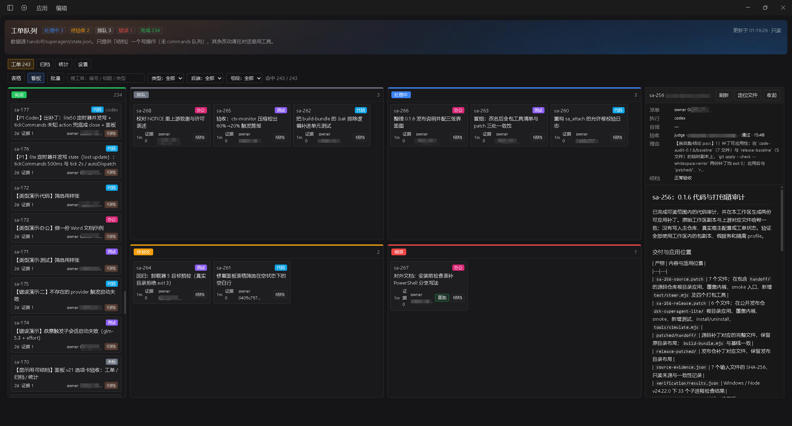
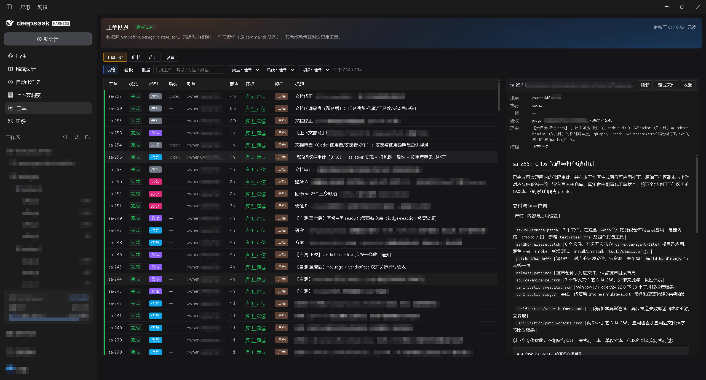
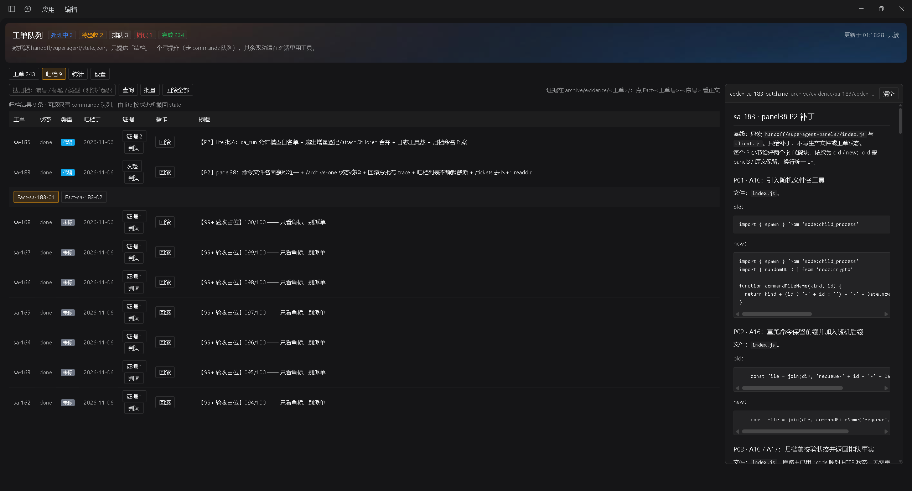
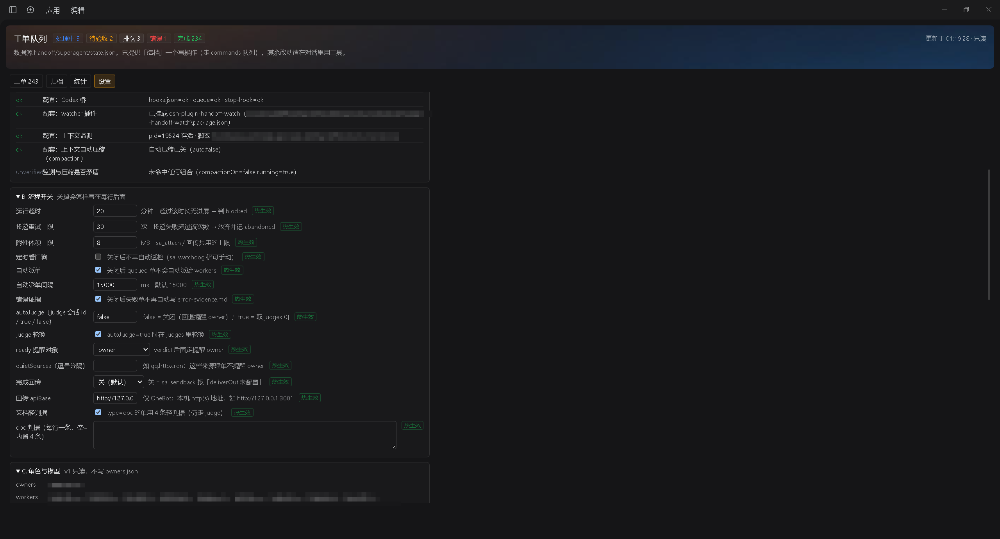

# dsh-superagent-lite

**给 DSH（DeepSeek Harness）用的轻量「工单 / 派活 / 双筛」框架。**

> 仓库：https://github.com/hcarsa-hub/dsh-superagent-lite
> 许可：MIT · 三个插件打包成一个可直接安装的捆绑包：

| 目录 | 包名 @ 版本 | 作用 |
|---|---|---|
| `packages/dsh-plugin-superagent-lite` | `dsh-plugin-superagent-lite@0.1.9` | 工单内核（含 `sa_steer` 中间插话）：**32 个 `sa_*` 工具**、状态机、证据链、双筛（worker → judge → owner）、自动派单、judge 轮换、`sa_compact` |
| `packages/superagent-lite-panel` | `dsh-superagent-lite-panel@1.0.0` | 面板（host + client 半部）：工单 / 归档 / 判词 / 设置 / 诊断 |
| `packages/handoff-watch` | `dsh-plugin-handoff-watch@0.3.0` | handoff watcher：把 Codex 回合结束事件投递到会话（跳过 superagent 自己的票） |
| `cordis.patch.bundle.yml` | — | 三条 `insert`，贴到 `<profile>/cordis.patch.yml` 末尾 |
| `install.mjs` / `uninstall.mjs` | — | 3 个主名 + 2 个兼容别名；安装默认计划、`--apply` 才写；**卸载无 dry-run，执行即删链接** |

内核注册 **32 个 `sa_*` 工具**（据补丁 FACTS），用途索引及逐项核对边界见 [内核 README](packages/dsh-plugin-superagent-lite/README.md)。包括工单、派活、双筛和运维工具，含 `sa_steer`、`sa_compact`、`sa_new_session`；原文分组中的 restore 无注册依据，已移除该列举。以下 `sa_*` 均在 DSH 会话中调用，非终端命令。

`sa_steer` 仅 owner，参数为 `sessionId/text/mode`（auto/steer/followup），auto 下 running 走 steer、idle/unknown 走 followup；await 投递结果，同步/异步失败均 `{ok:false}`，不写账本/工单状态，Codex 执行体不支持。

> **定位**：DSH 里的**轻量工单编排层**（派活 → 干 → 独立验收 → 收口）。它**不是** DeepSeek 官方 superagent 的 lite 版或移植版；与本项目的差异与边界见 [`docs/comparison.md`](docs/comparison.md)。

## 界面

| 看板（四态一屏） | 表格 + 判词抽屉 |
|---|---|
|  |  |





> 截图取自在真实宿主上跑的一次演示数据（**演示工单事后已清理**，故图中单号在账本里查不到）：看板按「排队 / 处理中 / 待验收 / 错误」四态分列，表格页带判词抽屉，归档页把已收口单按纪元留下；数据源为 `handoff/superagent/state.json`。

## 快速开始（先检查、授权，再跑首单）

先读 [安装前检查与恢复](packages/dsh-plugin-superagent-lite/docs/install-operations.md)：命令行 Node ≥20，确认实际活动 profile、写权限与可用模型通道；宿主兼容版本范围未验证，按所需服务核对。离线链接可不联网，模型执行由所选通道决定；Windows junction 不要求管理员，非 Windows 使用符号链接，面板文件定位仅 Windows 可用。

在含 `install.mjs` 的解包根目录执行。示例默认 desktop，须改成实际 profile；不要原样执行含 `<...>` 的占位命令。

```powershell
$profileDir = Join-Path $env:USERPROFILE '.dsh/profiles/desktop'
# 1) 先看计划（不动文件）
node install.mjs --profile "$profileDir"

# 2) 真装：备份 patch → 建 5 个 junction → 追加三条 insert（按 id 幂等）
node install.mjs --profile "$profileDir" --apply

# 3) 先填写下面配置与首次 owner 授权，再冷启动 DSH
```

```bash
profile_dir="$HOME/.dsh/profiles/desktop"
node install.mjs --profile "$profile_dir"
node install.mjs --profile "$profile_dir" --apply
```

安装器先规划全部目标，正确链接跳过；`.bak-bundle` 备份冲突会在**任何写入前拒绝**。保留已有备份并查明冲突，失败不继续后续步骤。装完必须在首次加载前填写配置：

| 位置 | 填什么 | 不填的后果 |
|---|---|---|
| 内核 `ownerSessions` | 首次加载前从宿主 UI 取得真实会话 id；只读 `sa_whoami {}` 可作补救 | 仅首次不存在 `owners.json` 时播种；已有空名单不能靠改 patch 再重启修复 |
| 面板 `sessionId` | 同上 | 面板没有默认投递目标 |
| watcher `sessionId` | 同上 | **handoff 自动投递直接断**（宿主进程没有 `DSH_SESSION_ID`） |
| 内核 `attachRoots` | 显式加入项目产物目录的绝对路径 | 默认仅 stateDir 父目录（通常 `~/.dsh`）与系统临时目录，敏感路径仍拒绝，任意项目产物不能直接 attach |
| 内核 `config.queueDir`、watcher `config.queueDir` | 内核默认 `<stateDir>/../queue`、watcher 默认 `~/.dsh/queue`。**改了 `stateDir` 就必须同时写 `queueDir`，且两处必须逐字相同**（第三处是 hook 的 `HANDOFF_QUEUE`） | 事件读不到、工单不会自动 ready；不能只凭 `codexOffset` 不动就判定路径错 |
| hook 环境变量 `HANDOFF_QUEUE`（桥启用时） | 显式指向上述队列；它不是第三个 config 键 | hook 默认值独立，可能写到另一个目录 |

模板默认已经开了 **`autoJudge: true` + `judgeRotate: true`**：工单到 `ready` 会自动送审给 `owners.json` 里登记的第一个 judge，多个 judge 时轮流派；没登记 judge 时自动跳过，通知仍发给 owner。

已有错误启动产生的 `owners.json` 时，由现有 owner 授权，或停写备份后仅追加 `owners` 数组中的目标 id，保留其他角色、模型与白名单，见 [首次授权恢复](packages/dsh-plugin-superagent-lite/docs/install-operations.md)。冷启动核对 `role=owner` 后，按 [首单教程](packages/dsh-plugin-superagent-lite/docs/getting-started.md) 准备三个独立角色完成闭环；只登记 judge 不会开启自动送审。

## 验收清单（内核必验，配套选验）

必验项为内核加载、owner 权限与首单闭环；面板/watcher/Codex/judge 轮换按安装情况选验。隔离事件样例、日志实际绝对位置的取得方法和预期见 [分层验收](packages/dsh-plugin-superagent-lite/docs/verification.md)，不向正式队列投测试事件。

| 项 | 怎么看 | 期望 |
|---|---|---|
| 内核加载（必验） | `<stateDir>/lite.log` 最后一条 `tools registered:` | **32 个** `sa_*`，含 `sa_steer`、`sa_compact` |
| 写权限 | `sa_whoami` | `role=owner` |
| 建单及闭环（必验） | `sa_submit {"title":"smoke","type":"test","auto":false}` 后按首单教程派活、attach/report、送审、判词、收口 | 返回当前纪元号；judge pass 后由 owner 推 done |
| 面板 | 侧栏「工单」入口 + 面板页 | 四页可点、设置页能保存 |
| watcher 启动 | `watch.log` 里 `watcher started: … session=…` | `session=` 后面**不为空** |
| watcher 真投递 | 往 `queue/events.jsonl` 投一条真 handoff | 必须出现 **`delivered: <文件>`**（只有 `skipped` 不算通过） |
| 内核吃事件 | 投事件后看 `state.json` 的 `codexOffset` | **值变大**（恒 0 = 两个 `queueDir` 解析到了不同目录） |
| judge 分流 | 两张 `type:test` 单推到 `ready` | `lite.log` 出现 `judge-rotate pick=…` 且两张单 judge 不同（只登记 1 个 judge 时固定进它，属正常） |
| 无报错 | 宿主日志搜 `failed to import` | 0 条 |

自动派单单独核对：`sa_submit` 的 `auto` 默认 true，实际派出还需全局 `autoDispatch:true` 与已登记、`kind` 匹配且可接单的 worker；首单显式 false 以手工验证。

**安装者不必跑开发闸门**；维护者可用仓库根的两支脚本：`node tools/verify.mjs`（末行 `VERIFY: ALL PASS`）与 `node tools/simulate.mjs <bundle 目录>`（安装器自证：建链 / 追加 insert / 幂等 / 卸载，全程在临时目录，不碰真实环境）。0.1.6 实测：bundle-audit A–M 全 PASS、bundle-isolate 6 项全过、bundle-simulate 11 条断言全过、kernel smoke 195 条断言全过、manifest 87 个文件逐个 sha256 通过。分层验收与隔离事件样例见 [分层验收](packages/dsh-plugin-superagent-lite/docs/verification.md)。

## 卸载 / 回滚

```powershell
# 顺序：先停用 patch，再删链接，最后重启 —— 反了宿主下次启动会报「解析不到包」
# 1) 停写并备份：停止宿主与 watcher/hook 等相关写入，备份完整 stateDir 与 profile
# 2) 把 cordis.patch.yml 里三条 insert 注释掉（或恢复 install 生成的 .bak-bundle-<时间戳>）
# 3) 删 5 个 junction（3 个主名 + 2 个兼容别名）：没有 dry-run，执行即删；
#    脚本先检查全部 5 个目标，任一是真实目录/文件就整次拒绝（exit 3）、一个不删
node uninstall.mjs --profile "$profileDir"
# 4) 重启 DSH；数据与旧包目录保留
```

Bash 对应 `node uninstall.mjs --profile "$profile_dir"`。卸载**没有 dry-run**；先检查 5 个目标，任一普通目录/文件就整次拒绝（exit 3），通过后只 unlink junction/符号链接。

升级采用新旧解包目录并存、保持包名、切换同名链接目标：停写完整备份 → 停用 insert → 旧目录卸链接 → 新目录计划并安装 → 恢复配置 → 冷启动验收。回滚反向切回旧目录链接并恢复配套配置/必要的数据快照；只恢复 patch 不能恢复旧代码。完整可核对命令与备份冲突处理见 [升级与回滚](packages/dsh-plugin-superagent-lite/docs/install-operations.md)。目标宿主实操未验证。

## 它解决什么问题

一个 agent 干活，**没有账本、没有验收、没有留痕**是常态。这套东西把「任务」变成有状态的对象：

```
queued ──派活──▶ running ──交活──▶ ready ──judge pass 后 owner 收口──▶ done
   │                │                 │
   └────────────────┴─────────────────┴──▶ blocked（前三态可进；blocked → queued/done）
```

judge pass 仍为 ready；done 是终态，`NEXT.done=[]`，不能再转 blocked。现行图见 [内核状态机](packages/dsh-plugin-superagent-lite/README.md#状态机)。

- **角色分层**：owner（决策/派活/收口）· worker（执行、交证据）· judge（独立验收）
- **证据链**：产物登记进 `evidence/<ticket>/` + 自报 + 判词，全部落盘可追溯
- **双筛**：worker 交的东西先过 judge（`sa_verdict`），owner 只做机械核验与收口
- **不绑模型**：worker 可以是 Codex、也可以是另一个 DSH 会话；`sa_run` / `sa_fanout` 两种派法
- **不碰宿主内部**：只通过 DSH 的 `tools` / `schedule` / `sessionController` 公开服务交互

## 已知边界（不是 bug）

- 面板设置页/诊断要**冷启动**才全生效；host 半部改 patch 会热重载，但 **plugin config 是加载时读一次**——改 `autoJudge` 这类键要重启（或换新 id 重新挂载）。
- `sa_compact` 要求目标会话空闲；压缩后上下文水位要等目标跑完一轮才刷新。
- 程序化建的会话（`sa_new_session`）**侧栏不显示**（宿主不写 `workspace.json`），属宿主限制。
- 本仓库不含 QQ / Codex 运行环境（NapCat、`codex.exe`），它们属外部依赖；桥脚本在 `packages/dsh-plugin-superagent-lite/integrations/` 只有参考实现。
- 内核 `docs/diagrams/` 带了系统框图与状态机图（PNG 占了大半体积），不需要可以删。

## 设计取舍

1. **内核零第三方依赖**：宿主按 patch 挂载；能直接解析链接时无需额外登记 profile dependencies，要求登记的宿主按其包管理器处理且仍需 insert。具体宿主版本分支未验证，见安装操作。
2. **四处身份必须同名**：`package.json` 的 name / `index.js` 的 `export const name` / `client.js` 的 `__ModuleLoader__.load({id})` / 自带 `cordis.patch.yml` 必须同名，否则插件整块不生效（踩过两次）；升级换的是**目录**，名字保持稳定（0.1.6 起内核为 `dsh-plugin-superagent-lite`）。
3. **脱敏**：包内不出现本机路径与会话 id，默认值统一成 `~/.dsh/subagent`；真实路径由 patch config 提供。
4. **可校验**：`manifest.json` 记录每个文件的 sha256（随 release 提供），解包后可逐字节核。

## 许可与致谢

- 代码：**MIT**（见 `LICENSE`）
- 外部项目引用与致谢见 [`NOTICE.md`](./NOTICE.md)：设计上参考了 DeepSeek 官方开源的 **Super-Agent**（`dsh-superagent-prototype`）的问题视角与角色分层，**代码为独立编写、未复制其源码**。

## 目录结构

```
.
├─ packages/                  三个插件（可直接 junction 到 <profile>/node_modules）
│  ├─ dsh-plugin-superagent-lite/   内核（index.js 含全量注释）
│  ├─ superagent-lite-panel/      面板（host + client）
│  └─ handoff-watch/              watcher
├─ （开发闸门）               审计 / 安装器自证 / 隔离实测仅在携带相应源码的开发交付中运行
├─ cordis.patch.bundle.yml    三条 insert 模板
├─ install.mjs / uninstall.mjs
├─ LICENSE · NOTICE.md · CHANGELOG.md
```
