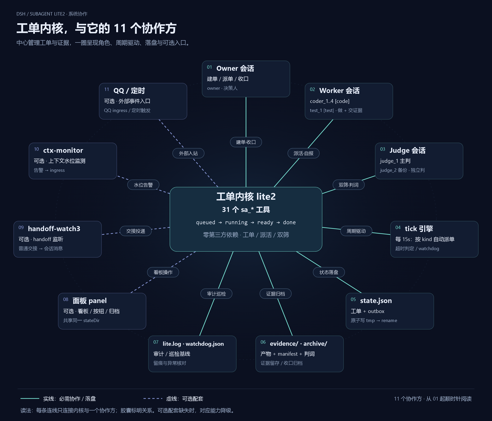
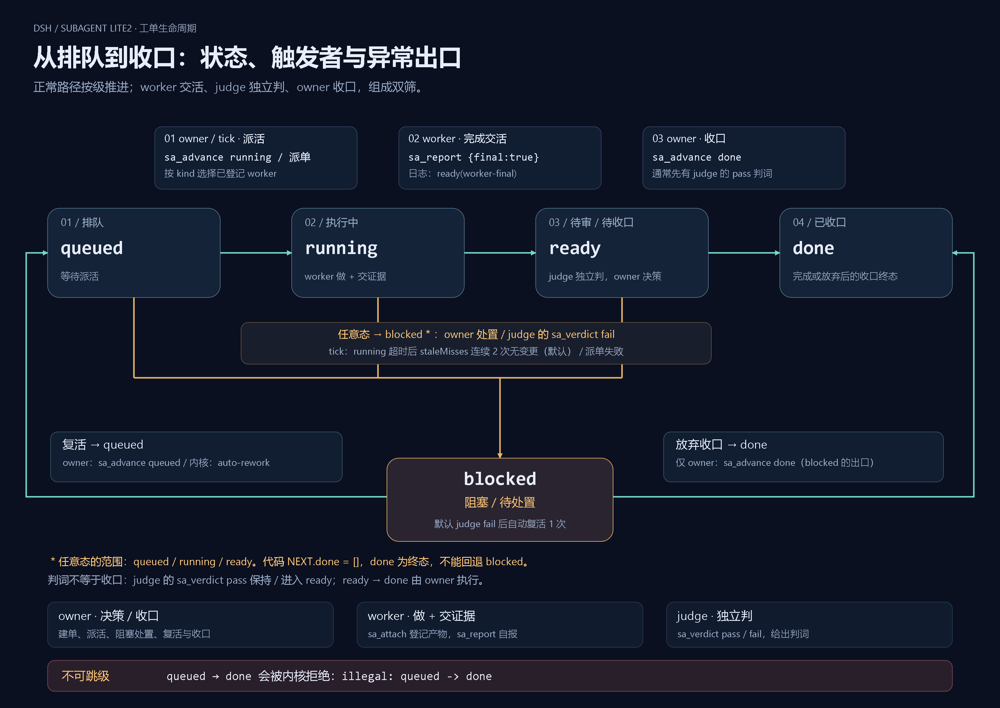

# dsh-plugin-subagent-lite

**工单 / 派活 / 双筛内核，不是 subagent provider。** 它不实现子代理、不提供模型、不造会话；它只把
「提一张单 → 派给谁干 → 谁验收 → 谁收口」变成可审计的状态机，真正的执行体（子会话、模型、会话管理）
全部由宿主的 `tools` / `schedule` / `subagents` 服务提供。

一句话：**工单（queued→running→ready→done）+ 角色（owner/worker/judge）+ 证据（attach/manifest）+ 双筛（worker 自报 + judge 独立判）**。

## 系统框图（内核发散式）



- **可交互版 / 导出无损 PNG**：[打开内核发散图](docs/diagrams/system-radial.html) —— 页面右上角有「导出 PNG（3×）」，点一下拿到 **5040×4320 的无损 PNG**；也可以直接取仓库里已渲染好的 [3× PNG](docs/diagrams/system-radial@3x.png)。
- 读法：**所有连线都从中心的内核出发**。中心 = `index.js` 里的 **31 个 `sa_*` 工具**（工单状态机）；一圈 = 协作方（Owner / Worker / Judge 会话、tick 引擎）与它唯一落盘的地方（`state.json` / `evidence/` / `lite.log`）；虚线 = **可选配套**（面板、handoff-watch3、ctx-monitor、QQ ingress），缺了只是降级。
- 旧版存档保留在 `docs/diagrams/` 目录。

> **结论：本插件不依赖任何第三方插件包**；免费模型、QQ 通道、Codex 桥、watcher、面板都属**可选配套**，
> 缺任一都只是功能降级，不会加载失败（`subagents`/`schedule` 缺失时给明确错误，不静默失败）。
> 完整依赖表见 [`docs/dependencies.md`](docs/dependencies.md)。

- 包名：`dsh-plugin-subagent-lite` · 版本 `0.1.7` · 入口 `index.js`（ESM，零第三方依赖）
- 插件 id：`subagent-lite`（`cordis.patch.yml` 里的 `id`）
- 所有工具都以 `sa_` 开头，共 **31** 个（工具面清单见下文与 `docs/design.md`）

---

- `sa_progress {id, note?}`：worker 长活心跳（刷新 updatedAt、防超时误杀）
- `sa_compact {sessionId | id}`：**压缩指定会话的上下文**（等价于在该会话手打 `/compact`，不经过模型）。owner-only，要求目标会话空闲；冷会话会被宿主 resume。实现 = `sessionController.resolveAgent` + `commands.execute(agent,'/compact')`，因此会在目标会话日志留 `command/run`+`command/done`。
  - 注意：压缩后目标的上下文水位（projcache）要等它跑完下一轮才刷新，**压完立刻看还是旧值**。

## 能干什么 / 不能干什么

**能**

- 工单全生命周期：提交、排优先级、派给子代理或已登记会话、卡住置 blocked、收口归档、按纪元滚动工单号
- 角色化权限：`owners`（决策）/ `workers`（接活交证据）/ `judges`（独立验收）；越权调用统一返回 `forbidden` + 授权指引
- 证据链：`sa_attach` 把产物写进 `evidence/<id>/` 并登记 manifest；`sa_evidence` 核对缺件/孤儿文件
- 双筛流程：worker `sa_report` 自报 → judge `sa_verdict` 独立判 → owner `sa_advance` 收口
- 投递：工单进入 `ready` 后进 outbox，按 tick 逐条投递（宿主 `schedule` 服务）；失败重试，不静默丢
- 可选能力：Codex 后端（`inboxFile` + Stop 钩子）、ingress 外部事件源、自动派单、watchdog 巡检

**不能**

- 不带面板 UI（面板是另一个包）；不带 LLM 调用、不带子代理实现；没有 `subagents` 服务时不能 `sa_run`
- 不替你管理宿主会话、不写宿主 hooks、不碰宿主配置
- 不内置压缩/记忆；长时间跑建议自己配上下文压缩

---

## 本插件会 / 不会创建什么

（以代码为准，不是愿景；默认 `stateDir` = `<home>/.dsh/subagent`）

**不会**

- 不创建工作区、不写 `~/.dsh/sessions` 目录；**不写宿主任何配置文件**（`cordis.patch.yml`、profile 的 `package.json`、`settings.json`、hooks 全都不碰）
- ~~不创建会话~~ → **sa-201 起：可以通过 `sa_new_session` 请求宿主建会话**（调 `sessionController.create`，会话本体仍由宿主管；`cwd` 白名单默认全拒）。除此之外不会自建会话。
- 不联网、不读凭据、不执行宿主/Codex 命令；派活只是调用宿主的 `schedule` / `subagents` 服务
- 不内嵌模型/provider，不改任何会话的提示词或 AGENTS
- 不会凭空造 worker：见下面「派活三条路」

**会**（默认都落在 `stateDir` 内）

| 落盘物 | 何时出现 |
|---|---|
| `state.json` + `state.json.bak` | 首次写操作（提交/推进/归档）；原子写（临时文件 → rename） |
| `owners.json` | 首次启动（按 `ownerSessions` 播种，之后热读） |
| `lite.log` / `watchdog.json` | 启动即写日志；巡检基线 |
| `commands/` / `archive/` | 启动即建；归档时才建 `archive/tickets` `archive/verdicts` `archive/handoff` `archive/evidence` |
| `evidence/<id>/` | 第一次 `sa_attach` 或工单产生产物时 |
| `queueDir/events.jsonl` | 内核**只读**它（默认 `<stateDir>/queue`）；文件由 Codex hook 写，内核自己不创建 |
| `ingressFile`、`inboxFile`、`pitfallsInbox` | **只有显式配置了路径才会写**（默认关闭） |
| `*.tmp` 临时文件 | 原子写的过程产物，成功后 rename，不会长期留存 |

**派活三条路（事实）**

1. `sa_tell`：只给**已存在**的会话投一条消息（走宿主 `schedule`），不创建任何东西。
2. `sa_run`：调宿主 `subagents.startActivation({ delivery: 'parent' })` 起**临时子会话**；子会话的生命周期、目录、模型由**宿主**管，插件只负责传 prompt 和模型路由。
3. `sa_fanout`：`models` 模式 = 对每个模型各走一次 `sa_run`；`sessionIds` 模式只是给已登记会话发消息（走 `schedule`）。

**建会话（sa-201 起有程序化入口）**

- `sa_new_session { cwd, sessionId?, title? }`：**owner-only**，调宿主 `ctx.sessionController.create({ sessionId, cwd })` 建一个常驻会话并返回 sessionId。
- 前提：宿主提供 `sessionController`（没有则工具明确报错，其余工具不受影响）；`cwd` 必须落在 `config.sessionCreateRoots` 里。
- **`sessionCreateRoots` 默认 `[]` = 全拒**（红线：不配就建不了，绝不做成任意路径可建）；`cwd` 还必须是已存在的绝对路径目录。
- 没有 `sessionController` 或不想配白名单时，仍可在宿主 UI 里手动建会话。

**推论**：worker / judge 会话可以用 `sa_new_session` 程序化建，也可以在 UI 里手动建；建好后用 `sa_role` 登记。
`autoDispatch` 只往已登记的 `workers` 里投，**不会凭空造人**——建会话和派活是两件事，别混。

## 安装（三步）

### 1) 让宿主能解析到包

二选一：

**A. link（推荐，离线可用）**

```bash
# 在本包目录里执行；<profile> 例如 C:/Users/<you>/.dsh/profiles/desktop
node scripts/install.mjs --profile "C:/Users/<you>/.dsh/profiles/desktop"
# 只打印片段、不动文件系统：
node scripts/install.mjs --profile "..." --dry-run
```

脚本做两件事：在 `<profile>/node_modules/` 下建一个指向本包的 junction（Windows 用 junction，不需要管理员），并**打印**要贴的 patch 片段——它**不会**改宿主的 `cordis.patch.yml`。

**B. npm 安装（有 registry 时）**

```bash
npm i dsh-plugin-subagent-lite
# 然后确认 <profile>/node_modules/dsh-plugin-subagent-lite 存在
```

### 2) 把 insert 片段贴进 `<profile>/cordis.patch.yml`

模板见 `cordis.patch.yml`，最小可用：

```yaml
- insert:
    - id: subagent-lite
      name: dsh-plugin-subagent-lite
      config:
        ownerSessions: ['<你的会话 id>']   # 必填，否则所有写工具都会被拒绝
```

> 不给 `stateDir` 时数据落在 `<home>/.dsh/subagent`。

### 3) 重启宿主

插件在启动时挂载；工具出现后即可用。验证：在会话里调 `sa_whoami`，能返回 `sessionId=... | role=...` 就算挂上了。

### 最小可用配置

```yaml
- insert:
    - id: subagent-lite
      name: dsh-plugin-subagent-lite
      config:
        ownerSessions: ['<owner 会话 id>']
        sessionId: '<默认投递会话 id>'      # 可选，投递兜底用
        subagentProvider: 'spawn'           # 可选，sa_run 的子代理后端
```

`ownerSessions` 为空时：只读工具（`sa_status/sa_list/sa_next/sa_evidence/sa_stats/sa_agents/sa_owners/sa_whoami`）可用，所有写工具返回 `forbidden: 本插件还没有配置 ownerSessions...`。

---

## 接免费模型

本插件不内置任何模型/provider——模型能力来自宿主侧的 provider 插件（例如 `our-free-model`、`trae`、`raccoon`、`qodercn`、`deepseek-account`）。示例里的模型名只是**格式示范**，不要当默认值。

三条路由写法（详见 [`docs/models.md`](docs/models.md)）：

1. **单次派活**：`sa_run { id, provider, model, reasoning_effort }` —— 一个子会话，模型参数必须成对给。
2. **多模型并行**：`sa_fanout { id, models: [{ provider, model, reasoning_effort, label }] }`。
3. **按模型挑人**：先用 `sa_agents` 看每个已登记会话的 `model` 备注，再用 `sa_fanout { id, sessionIds: [...] }` 指派人。

模型白名单：`owners.json` 里**没有 `saRunAllow` 键 = 不限制**（任何人可指定模型）；**有该键 = 白名单**（数组，形如 `"provider/model"` 或 `"model"`，不在表里直接拒绝）。

> 模型名以宿主当前可用列表为准（`list_subagent_models` 或模型选择器）；换机/换插件就会变。

## 可选：Codex 桥（`integrations/codex-bridge/`）

要把工单交给 **Codex 后端**（`sa_delegate_codex`）并让它「跑完自动把单推回 ready」，需要这个桥：

- 它不是网络插件，是「文件队列 + 去重键」契约：Stop hook 往 `<queueDir>/events.jsonl` 追加一行，插件的 `tickCodex` 增量读
- **不装它也完全可用**：`sa_delegate_codex` 仍写 handoff 文件，只是要你自己用 `sa_list` / `sa_watchdog` 发现完成
- 目录里带：Stop hook、PermissionRequest hook、`.cmd` 启动器模板、`hooks.json.example`、`contract.md`、可选 watcher 插件
- 开法、契约与已知坑（Windows 引号 / 改完重新信任 / queue 目录必须同一个）：[`integrations/codex-bridge/README.md`](integrations/codex-bridge/README.md) · [`contract.md`](integrations/codex-bridge/contract.md)

## 可选配套（companions）

内核**不 import 任何配套**，配套都是独立插件或本地脚本；装不装都能跑内核，只是少一路能力。完整表见 [`docs/companions.md`](docs/companions.md)。

| 配套 | 作用 | 不装会失去什么 | 怎么装 |
|---|---|---|---|
| `integrations/codex-bridge/` | Codex 回合结束写队列事件；权限请求转给 DSH 决策 | Codex 跑完不自动把单推回 `ready`（要自己 `sa_list`/`sa_watchdog` 发现） | 放长期路径 → `.cmd.template` 复制成 `.cmd` → 注册 hooks.json → **重新信任** |
| `integrations/codex-bridge/watcher/`（`dsh-plugin-handoff-watch`） | 把**非工单** handoff 投成会话消息 | 普通 handoff 不会叫醒人；**内核 `tickCodex` 仍在，Codex 派活的 ready 不受影响** | junction 到 `<profile>/node_modules/dsh-plugin-handoff-watch` + 贴它自己的 `cordis.patch.yml` + 重启 |
| 面板 UI（不在本包） | 看板/按钮/归档列表 | 只能用工具与 `state.json` 看进度 | 另装对应面板包，指向同一个 `stateDir` |

铁律：**queueDir 三处一致**；**不写 dependencies**（DSH 插件靠 patch 层注册，写 dependencies 只会把代码拖进 node_modules 却不挂载）；**代码零耦合**（内核只读队列增量，watcher 独立读同一份队列）。

## 31 个工具速查（按用途分组）

### 读（无副作用）

| 工具 | 作用 |
|---|---|
| `sa_status` | 各状态张数、待投递 outbox、状态文件路径 |
| `sa_list` | 工单明细列表（状态/后端/证据/标题） |
| `sa_next` | 下一张会被派出的工单 + 当前并发占用 |
| `sa_evidence` | 某张单的证据详情（清单/磁盘/缺件/解析方式） |
| `sa_stats` | 按状态/后端/来源/耗时/产物完整度统计 |
| `sa_agents` | 列出 owner/worker/judge/ops 及登记的模型（按任务挑人） |
| `sa_owners` | 写操作白名单 |
| `sa_whoami` | 自己的 sessionId + 是否有写权限 |
| `sa_requirements` | 某张单的追加需求清单（v1..vN）、revision、最近自报时间 |

### 写（需要 owner；`sa_report` 需要 worker/owner）

| 工具 | 作用 |
|---|---|
| `sa_submit` | 提一张工单（初始 queued） |
| `sa_advance` | 推状态：queued→running→ready→done，任意态→blocked |
| `sa_transfer` | 改工单归属会话（未投递的 outbox 跟着改目标） |
| `sa_role` | 给会话分配角色：owner/worker/judge/ops/none |
| `sa_owner_add` / `sa_owner_remove` | 增删写白名单（不许删掉最后一个 owner） |
| `sa_report` | **worker 交活自报**（做了什么 + 证据在哪） |
| `sa_tell` | 把一条任务直接投到指定会话（跨工作区派活） |
| `sa_attach` | 把产物登记进 `evidence/<id>/`（内容或已有文件） |
| `sa_progress` | worker 长活心跳：刷新 updatedAt、把超时计数归零 |
| `sa_compact` | **压缩指定会话上下文**（owner-only，= 在该会话跑 `/compact`；要求目标空闲） |
| `sa_new_session` | 请求宿主建会话（cwd 白名单默认全拒；侧栏不显示，见 known-limitations） |

### 派活

| 工具 | 作用 |
|---|---|
| `sa_run` | 把 queued 单派给 DSH 子代理（需要宿主 `subagents` 服务） |
| `sa_fanout` | 扇出：派给多个会话，或多个模型各起一个子会话 |
| `sa_delegate_codex` | 转给 Codex 后端（写 `inboxFile`，需宿主 Stop 钩子收口） |
| `sa_ingress` | 往 ingress 队列投一条外部事件（source/key/title/body） |
| `sa_sendback` | 把产物回传到来源 QQ（默认 dry-run） |

### 验收

| 工具 | 作用 |
|---|---|
| `sa_judge` | 把单交给 judge 会话做独立验收（附判据） |
| `sa_verdict` | judge 下结论：pass → ready；不通过 → blocked + 自动投坑 |
| `sa_escalate` | 把「坑在哪」写进坑投递箱（发消息会叫醒运维，所以只落文件） |
| `sa_watchdog` | 立刻跑一次巡检（默认只检查；`dryRun=false` 才告警） |

### 归档

| 工具 | 作用 |
|---|---|
| `sa_archive` | 把已收口（done/blocked）的单移出 state.json，落 `archive/<纪元前缀>.json` |

---

## 状态机



[打开状态机流程图 / 导出 PNG（3×）](docs/diagrams/state-machine.html) · [3× 无损 PNG（5040×3570）](docs/diagrams/state-machine@3x.png)

图中正常流为 worker `sa_report {final:true}` 交活进入 ready，judge 独立判词后由 owner `sa_advance done` 收口；按代码 `NEXT.done = []`，done 不能回退 blocked。下方保留原有文字示意。

```
            sa_advance            sa_verdict pass / sa_advance
  queued ─────────────▶ running ─────────────────────────▶ ready ──▶ done
    │                     │                                  │        ▲
    │  blocked            │ blocked                          │        │ sa_advance
    ▼                     ▼                                  ▼        │
  blocked ◀──────────── blocked ◀──────────────────────── blocked ──▶ queued
    │  （任意态可 blocked；blocked 可重排回 queued，也可人工收口 done）
    └──▶ done
```

- 工单号按纪元滚动：`sa-001…sa-999` → `s1-001…s1-999` → `s2-…`；换纪元时旧单自动归档
- `ready` 即「等 owner 收口」：进入时投递 outbox（key = `ticketId:revision`），成功才标 sentAt，重启后继续投

---

## 数据目录布局（`stateDir`，默认 `<home>/.dsh/subagent`）

```
<stateDir>/
  state.json            # 工单主状态（tickets / outbox / seq / 游标）
  state.json.bak        # 上一版备份（原子写）
  owners.json           # 角色名单：owners/workers/judges/ops/children/models
  settings.json         # 运行期开关（autoDispatch / watchdogAlerts / 超时 / 裁剪窗口）
  lite.log              # 插件自身日志（append）
  evidence/<id>/        # 每张单的证据目录（manifest.json + 产物）
  archive/              # 归档：tickets/ 与按纪元前缀的 json
  commands/             # 面板/外部写命令、插件 tick 执行
  codex-<id>.md         # Codex 后端的历史产物（只读兼容）
```

外部通路：

```
queueDir/events.jsonl   # 默认 <stateDir>/queue；Codex Stop 事件流，tickCodex 只读（增量 codexOffset）
ingressFile             # 默认关闭；外部事件投递队列（tickIngress 按 key 去重后建单）
inboxFile               # 默认关闭；sa_delegate_codex 写的 handoff 文件
```

> **queueDir 三处必须同一个目录**：Codex hook 的 `HANDOFF_QUEUE` = 内核 `config.queueDir` = watcher `config.queueDir`
> （默认都是 `<stateDir>/queue`）。一边 A 一边 B 是最常见的「装了但没反应」。

---

## 验收清单（贴命令，看末行）

在包目录里：

```bash
node --check index.js          # 期望：无输出、exit 0
node test/smoke.mjs            # 期望末行：SMOKE: ALL PASS
npm pack --dry-run             # 期望：列出将打包的文件，不含 node_modules
node scripts/install.mjs --help  # 期望：打印用法、exit 0、不写任何文件
```

脱敏自检（期望 0 命中）：

```bash
node test/smoke.mjs     # 第 3 节会逐文件扫描本机痕迹（内部路径、会话 id、人名、内部工区名），命中即 FAIL
```

> 具体的禁止词表故意只放在 `test/smoke.mjs` 里，不用字面量写在文档中——否则文档自己就会命中扫描。

宿主侧（挂载后）：

```
sa_whoami   → sessionId=<你的 id> | role=owner（先把自己配进 ownerSessions）
sa_status   → tickets=0 queued=0 ... | default=(none)
```

---

## 参考与致谢

设计参考 DeepSeek 官方开源的 **Super-Agent** 项目：https://github.com/deepseek-ai/dsh-superagent-prototype （Towards a More Autonomous Agent System）。我们借用其问题视角与角色分层，代码独立实现；本包不包含其源码，也未与其产生运行时依赖。

## 致谢与图表来源

本包的图有两代，来源不同，都在 `docs/diagrams/` 里，且都保留可复现的源文件：

| 图 | 现在用在哪 | 生成方式 | 复现 |
|---|---|---|---|
| `system-radial.{html,png,@3x}` | README「系统框图」 | **Codex CLI + `gpt-6.1-sol`** 手写内联 SVG（单文件、零外链、自带 3× 导出按钮） | 直接双击 HTML；或按页面按钮导出 PNG |
| `state-machine.{html,png,@3x}` | README「状态机」 | 同上 | 同上 |
| `architecture.{html,png}` + `architecture.candidate.json` | **旧版存档**（README 不再引用） | **Archify 3.2.0**（`architecture` 类型，showcase 质量档） | 见下 |
| `architecture-radial.{html,png,@3x}` | **旧版存档** | 本项目手写 SVG（第一版尝试） | 直接双击 HTML |

### Archify 引用说明

- 使用版本：**Archify 3.2.0**（skill 路径 `~/.agents/skills/archify`，与 Codex 共用同一份安装）。
- 上游：`https://github.com/tt-a1i/archify`，许可 **MIT License, Copyright (c) 2026 tt-a1i (Archify)**。
- 本包只分发它 **生成出来的产物**（`architecture.html` / `architecture.png` / `architecture.candidate.json`），**不包含也不依赖 Archify 的代码**；运行时不需要装 Archify。
- 重新渲染（在本包根目录执行，需 Node ≥ 18 与 Chromium/Edge）：

  ```powershell
  $env:ARCHIFY_CHROME = 'C:\Program Files (x86)\Microsoft\Edge\Application\msedge.exe'  # 本机只有 Edge
  node "$env:USERPROFILE\.agents\skills\archify\bin\archify.mjs" finalize architecture `
    docs/diagrams/architecture.candidate.json docs/diagrams/architecture.html --quality showcase --json
  ```

  `finalize` 会依次跑 validate → deliver → check → browser-check 四道闸门，四项全 `pass` 才算成功（本包这份就是这样过的）。改了候选 JSON 后重跑要给新证据目录：加 `--out-dir review-2`。

- 两个坑（踩过）：① **不要装** `@tt-a1i/archify-dsh` 适配包（自带 3.0.1 会盖掉 3.2.0，还有让个人技能消失的已知 bug）；② 沙箱会拦子进程导致 `spawn EPERM`，必要时把这一条命令按完全放开权限跑一次。

> 为什么两代都留着：Codex 版视觉更好（现在 README 用这两张），Archify 版带引导视图 / 路径高亮适合交互讲解，所以作为存档保留、并可一键重渲染。

## 文档索引

| 想知道什么 | 看哪份 |
|---|---|
| **5 分钟装起来并跑完第一张单** | [`docs/getting-started.md`](docs/getting-started.md) |
| **建几个工作区、几个会话、名字怎么起** | [`docs/team-layout.md`](docs/team-layout.md) |
| **一整圈的时序、谁在等谁、卡了怎么退** | [`docs/loop.md`](docs/loop.md) |
| **每个角色该给什么提示词** | [`docs/prompts/`](docs/prompts/)：owner · worker · tester · judge · codex · qq |
| 全部配置项与副作用 | [`docs/config.md`](docs/config.md) |
| 模型路由三条路 | [`docs/models.md`](docs/models.md) |
| 依赖关系（哪些是必须、哪些是可选） | [`docs/dependencies.md`](docs/dependencies.md) |
| 可选配套（面板/QQ/Codex 桥等） | [`docs/companions.md`](docs/companions.md) |
| 设计取舍 | [`docs/design.md`](docs/design.md) |
| **下文监测要不要运行** | [`docs/ctx-monitor.md`](docs/ctx-monitor.md) |

> 提示：`docs/prompts/` 里每份都是**可直接抄走的工作区级 `AGENTS.md` 模板 + 会话级首条提示词**。
> 端口/路径/session id 全部写成 `<占位符>`，换成你自己的值即可。

---

## 上下文监测（可选）

**一句话：宿主自己压缩上下文时不要跑，不压缩时要跑。**

包内自带一个零依赖的小工具 [`tools/ctx-monitor.mjs`](tools/ctx-monitor.mjs)：只读 DSH 的会话快照，
算上下文占用百分比，超阈值就提醒你换会话或手动 `/compact`。**默认关闭，不自动启动**。

| 你的情况 | 要不要跑 |
|---|---|
| 卸载了 compaction 插件，或配了 `auto:false` | **要跑**（否则会话到顶了才突然发现） |
| 装了自动压缩（`auto:true`） | **不要跑**（重复告警 + 压缩后误判） |
| 不确定 | 先看面板「一键体检」的诊断结论 |

完整决策矩阵、阈值说明、怎么停 → [`docs/ctx-monitor.md`](docs/ctx-monitor.md)；
怎么跑 / 参数 / 文件落在哪 → [`tools/README.md`](tools/README.md)。

---

## 已知限制

- **不带面板 UI**：看板/按钮在另一个包里；本包只有工具和状态机
- **`sa_attach` 的允许根必须显式配置**（`attachRoots`），否则只允许 `stateDir` 上一级与系统临时目录；敏感路径（`.ssh`/`.gnupg`/`.dsh`/`.aws`/`*.pem`/`credentials.json` 等）在任意根内都会被拒绝
- **宿主可能要求包登记在 profile 的 `dependencies`**：junction 只解决「能解析到文件」，有些 DSH 版本还要求 `<profile>/package.json` 里有 `"dsh-plugin-subagent-lite": "link:<包目录>"` 并跑过包管理器；`scripts/install.mjs` 会把这条命令打印出来
- **写 `<profile>` 需要管理员/免沙箱权限**：在受限沙箱里跑 install 会 `Permission denied`（系统级修改请在宿主 profile 目录有写权限的会话里做）
- **Windows 路径**：所有路径按宿主进程的默认路径语义解析；跨盘/UNC 路径请用绝对路径；junction 由 `scripts/install.mjs` 建（不需要管理员）
- **`sa_run` 依赖宿主 `subagents` 服务**：没开 delegation 时只有 `sa_run`/`sa_fanout` 不可用，其余工具照常
- **投递依赖宿主 `schedule` 服务**：没有它时工单会积压在 outbox（不丢），`sa_advance` 到 ready 不报错但不会有人被叫醒
- **子代理模型路由**：需要 `provider`+`model` 成对给，且父会话要有模型策略，否则宿主会拒绝子模型选择
- **无自动压缩配合**：工单 + 证据会持续占上下文，长跑请自行配压缩策略
- **单实例**：同一 `stateDir` 只应挂一个实例（状态文件是进程内串行写，没有跨进程锁）

---

## 卸载

```bash
# 1) 删掉 <profile>/cordis.patch.yml 里那段 insert（scripts/uninstall.mjs 会打印要删的段落）
node scripts/uninstall.mjs --profile "C:/Users/<you>/.dsh/profiles/desktop"

# 2) 只删 link，不动数据
#    数据目录 <home>/.dsh/subagent 需要你手动决定保留还是删除
```

脚本只删 junction 并打印要删除的 YAML 段落，**不自动改宿主文件、不删你的数据**。
